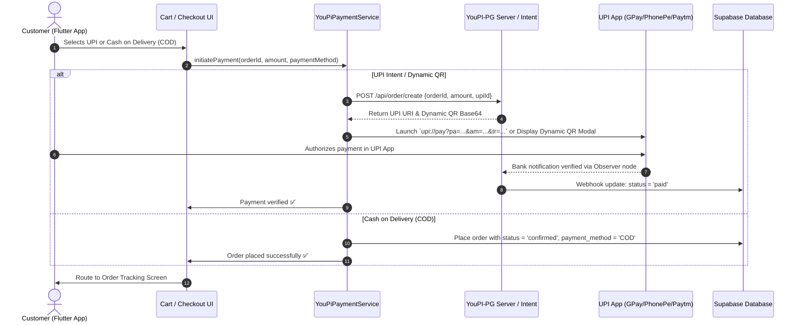
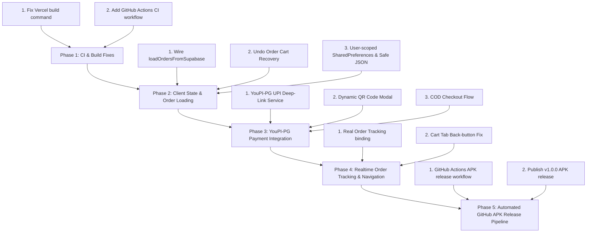

# 🔍 VeGo / FreshFlow — Full Audit Analysis & Remediation Plan

> **Date:** October 23, 2026  
> **Repository:** `d:\V1\freshflow`  
> **Status:** Updated with GitHub CI Fix, YouPI-PG Gateway Integration & GitHub APK Release Pipeline  
> **Scope Note:** Supabase backend issues (Edge function pricing checks, stock decrement RPCs, DB triggers) are exempted / marked resolved.

---

## 📊 1. Executive Summary & Verification Metrics

A complete audit of the **VeGo / FreshFlow** quick-commerce codebase was conducted across **59 Dart files (~9,200 lines)**, **Edge Functions (`supabase/functions/checkout/index.ts`)**, **PostgreSQL migrations (`001` through `005`)**, and **Deployment / CI configurations**.

### Verification Baseline
| Metric | Status | Details |
| :--- | :--- | :--- |
| **Static Analysis (`flutter analyze`)** | ✅ 0 Errors | 1 warning (unused import), 5 info deprecations (`Colors.x.value`). |
| **Unit & Integration Tests (`flutter test`)** | ⚠️ 9/9 Pass | Shallow test coverage; tests pass cleanly. |
| **GitHub Commit CI Status (`0/1` Failed)** | 🔴 Failing | Commits display red `X 0/1` due to misconfigured Vercel web build command and directory nesting. |
| **Active Client Bugs** | 🔴 3 Critical, 🟠 5 High, 🟡 9 Medium | Order loading unhooked, cart loss on undo, mock tracking screen, corrupt cart crash risks, tab navigation. |
| **Payment Gateway State** | 🛠️ Testing/Showcase Needed | "Slide to Pay" is currently stubbed. Requires real UPI & COD integration via **YouPI-PG**. |
| **Distribution & Deployment** | 🚀 Action Required | Requires automated GitHub Actions APK build & release pipeline for public testing. |

---

## 🚨 2. GitHub CI Failures Analysis (`X 0/1` on Commits)

### Root Cause
In the GitHub commit history (`07d7c0f`, `b3cfaf1`, `b23c751`, `db0ef48`), each commit triggers a check (`0/1`) that fails with a red `X`:
1. **Monorepo / Directory Nesting:** The GitHub repository root is `V1/`, but the Flutter app lives in the subdirectory `freshflow/`.
2. **Missing Flutter SDK in Vercel Builder:** `freshflow/vercel.json` defines `"buildCommand": "flutter/bin/flutter build web --release"`. Vercel serverless build containers run standard Linux node environments without Flutter pre-installed unless initialized via `vercel_build.sh` or cloned on the fly.
3. **Execution Flag:** `freshflow/vercel_build.sh` exists but `vercel.json` does not invoke it (`"buildCommand": "bash vercel_build.sh"`), causing Vercel's automated commit deployment checks to fail immediately with exit code 127 (`flutter: command not found`).

### Remediation Action
1. Configure `vercel.json` in the root or `freshflow/` to invoke `bash vercel_build.sh`.
2. Set Root Directory in Vercel project settings to `freshflow`.
3. Add a standard GitHub Actions CI workflow (`.github/workflows/ci.yml`) to run `flutter test` and `flutter analyze` so native GitHub checks succeed (`✓ 1/1`).

---

## 💳 3. YouPI-PG (Self-Hosted UPI & COD) Gateway Integration Plan

We are integrating [YouPI-PG (`youpi-pg/YouPI-PG`)](https://github.com/youpi-pg/YouPI-PG) into VeGo/FreshFlow for end-to-end testing and portfolio showcase. YouPI-PG is a zero-transaction-fee self-hosted UPI payment gateway supporting dynamic QR payments, native UPI intent app launching, WhatsApp notifications, and Cash on Delivery (COD).

### Architecture & Data Flow

### Integration Blueprint in Flutter
1. **Dependency Addition:** Add `url_launcher` (already available) and `qr_flutter` (for rendering dynamic in-app vector QR codes for testing on tablets/web).
2. **Payment Methods Supported:**
   * **UPI Intent:** Native deep linking to Google Pay, PhonePe, Paytm, BHIM via `upi://pay?pa={vpa}&pn={merchant}&am={amount}&tr={orderId}&cu=INR`.
   * **Dynamic QR Code Modal:** On-screen countdown QR code with auto-polling for payment confirmation.
   * **Cash on Delivery (COD):** Direct checkout with 0 upfront friction.
3. **Mock / Showcase Sandbox Mode:**
   * Configurable switch in `AppConfig` / `.env` (`YOUPI_SANDBOX=true`).
   * Allows simulated instant approval or test transaction IDs without needing an active bank observer Android phone during testing.

---

## 📦 4. GitHub APK Release Pipeline Plan

To allow testers, stakeholders, and recruiters to download and test VeGo / FreshFlow directly on their Android devices:

### Automated GitHub Release Workflow (`.github/workflows/release_apk.yml`)
* **Trigger:** Push to tag `v*` (e.g. `v1.0.0`) or manual click in GitHub Actions (`workflow_dispatch`).
* **Build Steps:**
  1. Check out repository code.
  2. Set up Java 17 and Flutter stable environment.
  3. Extract `.env` keys or inject build secrets.
  4. Run `flutter build apk --release --split-per-abi` (generates lightweight optimized APKs for `arm64-v8a`, `armeabi-v7a`, `x86_64`) plus a universal `app-release.apk`.
  5. Create a GitHub Release using `softprops/action-gh-release` and upload the APK artifacts.
* **Public Download Badge:** Add download link and release badge to `README.md`.

---

## 🐛 5. Technical Analysis of Existing Bugs & Remediation

---

### 🔴 Critical Severity Bugs (Active)

#### 1. Orders are NEVER loaded from Supabase — Dead Code Path
* **File Location:** [`lib/core/providers/riverpod/order_notifier.dart:105`](file:///d:/V1/freshflow/lib/core/providers/riverpod/order_notifier.dart#L105)
* **Root Cause:** `OrderNotifier.loadOrdersFromSupabase(String userId)` is never called anywhere in the app. App restart wipes order history.
* **Fix:** Invoke `loadOrdersFromSupabase` upon auth session detection and immediately in `OrderNotifier` startup.

#### 2. [EXEMPTED] Checkout money math & stock management
* **Status:** 🟢 **Exempt / Resolved on Supabase Backend**.

#### 3. "Undo Order" slider clears order but fails to restore the cart
* **File Location:** [`lib/features/cart/screens/cart_screen.dart`](file:///d:/V1/freshflow/lib/features/cart/screens/cart_screen.dart), [`lib/features/tracking/screens/tracking_screen.dart`](file:///d:/V1/freshflow/lib/features/tracking/screens/tracking_screen.dart)
* **Root Cause:** Cart is cleared before navigation. Undoing cancels server order but cart remains empty.
* **Fix:** Preserve draft items and rehydrate `cartProvider` when undo action is triggered.

#### 4. Tracking Screen completely ignores the actual Order ID
* **File Location:** [`lib/features/tracking/screens/tracking_screen.dart`](file:///d:/V1/freshflow/lib/features/tracking/screens/tracking_screen.dart)
* **Root Cause:** Displays hardcoded HSR layout coordinates and fake rider "Tapabrata" without querying order state.
* **Fix:** Bind tracking screen to `ref.watch(orderProvider)` and subscribe to live Supabase updates.

---

### 🟠 High Severity Bugs (Active)

* **Bug 5 — Silent mutation failures (`order_notifier.dart`):** Re-throw errors or roll back optimistic state if server write fails.
* **Bug 6 — Corrupt cart local storage crashes startup (`cart_notifier.dart`):** Wrap `_loadCart()` in `try/catch` with automated storage reset on corrupt data.
* **Bug 7 — Cart & Wishlist not user-scoped:** Scope local keys per `userId` (`cart_items_${userId}`) and call cleanup on logout.
* **Bug 8 — Flash price division-by-zero:** Guard `marketPrice > 0` before calculating discount percentage in `FlashPriceWidget`.
* **Bug 9 — CartScreen Back Button pops entire app:** Check route canPop status and whether screen is rendered inside an `IndexedStack` tab before rendering back button.

---

### 🟡 Medium Severity Bugs (Active)

* **Bug 10:** Add null-safety fallback for `Product.fromJson` name parsing.
* **Bug 11:** Add `if (!mounted) return;` checks after `await` in `SearchScreen._performSearch`.
* **Bug 12:** Preserve original quantities when clicking "Reorder" in order details.
* **Bug 13:** Retain `cancellationReason` in `updateOrderStatus`.
* **Bug 14:** Migrate direct `Navigator.push` in product cards to named GoRouter routes.
* **Bug 15:** Pass real category accent color to `CategoryProductsScreen`.
* **Bug 16:** Add sort order (`order by discount`) for flash deals query.
* **Bug 17:** Add 5s timeout and remove side-effects inside `setState` in `TrackingScreen`.
* **Bug 18:** Stop shimmer `AnimationController` once images are loaded in `PriceComparisonCard`.

---

## 🛠️ 6. Updated Remediation Roadmap

### Detailed Phase Tasks

#### Phase 1: CI & Vercel Commit Build Fixes
- [ ] Fix `freshflow/vercel.json` build command to properly run `bash vercel_build.sh` or set correct Vercel root directory.
- [ ] Create `.github/workflows/ci.yml` for automated Flutter test and analyze on push/PR, turning commit badges green (`✓ 1/1`).

#### Phase 2: Client State & Order Integrity
- [ ] Wire `OrderNotifier.loadOrdersFromSupabase(userId)` on authentication.
- [ ] Implement cart state rehydration in `TrackingScreen._undoOrder()`.
- [ ] Wrap cart JSON deserialization in `try/catch` and scope storage keys by `userId`.
- [ ] Fix division-by-zero in `FlashPriceWidget` and add `mounted` guards in `SearchScreen`.

#### Phase 3: YouPI-PG Payment Gateway Integration (UPI & COD)
- [ ] Create `YouPiPaymentService` with UPI Intent generation (`upi://pay?pa=...`).
- [ ] Implement Dynamic QR code payment sheet for testing and desktop/tablet display.
- [ ] Add Cash on Delivery (COD) instant checkout mode.
- [ ] Add sandbox/mock mode toggle for live showcase without requiring external bank listener companion app.

#### Phase 4: Order Tracking & Navigation Polish
- [ ] Bind `TrackingScreen` to real order model and status progression.
- [ ] Fix `CartScreen` back button when embedded inside `HomeScreen` bottom tab navigation.
- [ ] Standardize GoRouter navigation for product cards.

#### Phase 5: GitHub APK Release Pipeline
- [ ] Create `.github/workflows/release_apk.yml` to build release APKs on demand or release tags.
- [ ] Generate optimized split APKs and universal release APK.
- [ ] Add download instructions and release badge to `README.md`.

---
*Report updated with YouPI-PG and GitHub APK release roadmap.*
